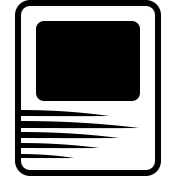

<!-- Copyright (C) 2026  Jonathan Pepin -->
<!-- SPDX-License-Identifier: GPL-3.0-or-later -->


# Okapia

**Run classic Mac OS on an Apple silicon Mac or boot it directly on a Raspberry Pi 4.** Okapia combines
[Basilisk II and SheepShaver](https://github.com/kanjitalk755/macemu) in one macOS app and one bare-metal
Pi kernel built on [Circle](https://github.com/rsta2/circle). Both hosts share a boot menu for choosing the
startup disk, switching engines and changing settings. The macOS app also prepares and updates Pi SD cards.

| Engine | Compatible systems |
|---|---|
| [68k · Basilisk II](docs/topics/engine-68k.md) | System 7.0.1 through Mac OS 8.1, with a 68040 and an 80-bit softfloat 68881 |
| [PowerPC · SheepShaver](docs/topics/engine-powerpc.md) | Mac OS 7.5.2 through 9.0.4 with a compatible Old World or New World ROM |

Bring a compatible Macintosh ROM and a bootable disk image for the System you want to run. You supply the Apple
software and disk images.

## Get started

**On macOS**, open Okapia, choose **This computer**, and create or open an **Okapia Workspace**. Add your ROM and
bootable disk image, then choose **Continue** to open the boot menu. The workspace folder holds your images and
preferences. See the [desktop guide](docs/topics/desktop.md#using-it).

**On a Raspberry Pi 4**, choose **Raspberry Pi 4** and **SD Card…** in the macOS app. With a release available,
**Prepare the Card** installs the Pi files. You can also copy the staged files or the contents of a Pi 4 release
archive to a FAT32 card with 32 KB clusters and add your ROM and disk images by hand.
See [the card preparation guide](docs/topics/desktop.md#using-it) and the [Pi setup guide](docs/getting-started.md).

Hold **Option** at startup to open the boot menu. On the Pi, choose **Special → Shut Down** in Mac OS before
switching off the power.

Check [GitHub Releases](https://github.com/jpep-in/okapia/releases) for published builds, or build from source below.

## Current status

Both engines reach the Finder on macOS and Raspberry Pi 4. The Pi has been tested over Wi-Fi and Ethernet.
The experimental 68k-to-AArch64 translator is built into the Apple silicon app. On the Pi it requires a kernel
built with `OKAPIA_JIT_ARM64=1`. On either host, the `jit` preference controls whether it runs.
See [Desktop status](docs/topics/desktop.md#status), [Network status](docs/topics/network.md#status) and
[Benchmarks](docs/contributing/benchmarks.md).

## Build from source

On an Apple silicon Mac with Homebrew and the Xcode command-line tools, initialise the dependencies and generate
the 68k opcode tables:

```bash
./scripts/install-tools.sh
git submodule update --init
./scripts/bootstrap.sh
./scripts/gen-cpu.sh
```

For macOS, build the app bundle at `build/desktop/Okapia.app`:

```bash
brew install pkgconf sdl3
./scripts/make-desktop-app.sh
```

For a Raspberry Pi 4, build the kernel and stage the card files in `rpi4-sd-contents/`:

```bash
brew install bash
./scripts/build-libs.sh pi4
. scripts/env.sh && "$MAKE" -C src/kernel
./scripts/make-pi-sd.sh
```

See [Build](docs/contributing/build.md) for target switching and
[Testing and debugging](docs/contributing/testing-and-debugging.md) for QEMU and host tests.

## Documentation

- [Documentation index](docs/README.md) and [preferences reference](docs/preferences.md)
- [Architecture](docs/project/architecture.md) and [roadmap](docs/project/roadmap.md)
- [Contributor guide](docs/contributing/guide.md) and [release procedure](docs/contributing/release.md)

AI agents should start with [`AGENTS.md`](AGENTS.md).

## Licence

Okapia is written by Jonathan Pepin and released under the [GPLv3 or later](LICENSE). Circle is GPLv3 (Rene Stange).
Basilisk II and SheepShaver are GPLv2-or-later (Christian Bauer, Marc Hellwig and contributors, carried on by
kanjitalk755). libhfs is GPLv2-or-later (Robert Leslie).

Okapia is an independent project with no affiliation with, endorsement by or sponsorship from Apple Inc.
Apple, Macintosh, Mac OS, Power Macintosh and Quadra are trademarks of Apple Inc., registered in the U.S. and
other countries.
