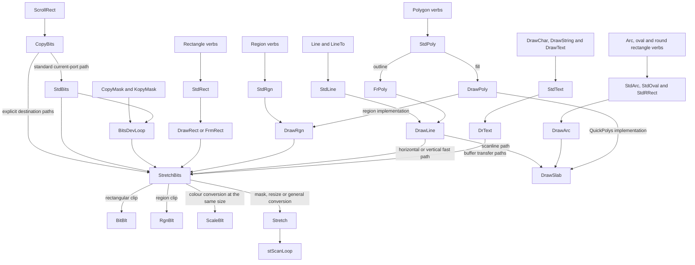

<!--
Copyright (C) 2026  Jonathan Pepin
SPDX-License-Identifier: GPL-3.0-or-later
-->
# Color QuickDraw call paths and 8-bit drawing

This map follows the standard Color QuickDraw procedures in the Apple source
under `reference/supermario/base/SuperMarioProj.1994-02-09`. Edges represent
possible calls, including conditional paths. The live Quadra ROM and System
patches need their own ABI checks before each new native hook is enabled.

## From drawing calls to pixels

The standard procedures are conditional edges. A port can supply a custom
`CQDProcs` entry, and picture playback dispatches drawing commands back through
the drawing API. Keep those dispatches, cursor protection, pen advancement and
the construction of update regions in guest QuickDraw.

| Edge or decision | Apple source |
| --- | --- |
| Scrolling translates the source rectangle, builds a mask region and calls `CopyBits`. It computes and erases the update region afterwards. | `QuickDraw/BitMaps.a:2241` |
| `CopyBits` can dispatch through the port's `bitsProc` or call `StretchBits` itself. `StdBits` and the masked device loop also reach `StretchBits`. | `QuickDraw/BitMaps.a:749`, `:1208`, `:1397`, `:1523`, `:1837` |
| Rectangle and region drawing supply the pattern and clip to `StretchBits`. | `QuickDraw/Rects.a:556`, `:667`, `QuickDraw/Regions.a:271` |
| Line drawing can take a transfer path or emit horizontal spans. Arcs, ovals and round rectangles share curve code. Polygon fill has two source implementations. | `QuickDraw/DrawLine.a:350`, `:621`, `:696`, `QuickDraw/Arcs.a:131`, `QuickDraw/Ovals.a:128`, `QuickDraw/RRects.a:134`, `QuickDraw/DrawArc.a:885`, `QuickDraw/Polygons.a:421`, `:464`, `QuickDraw/QuickPolys.a:814` |
| Standard text rasterizes glyphs and can pass a text buffer to `StretchBits`. | `QuickDraw/Text.a:916`, `:937`, `QuickDraw/DrawText.a:5501`, `:5585` |
| `StretchBits` expands patterns, protects the cursor and selects each transfer path. `ScaleBlt` can decline, in which case QuickDraw may use its general path. | `QuickDraw/Stretch.a:1149`, `:1161`, `:1225`, `:1445`, `:1494`, `:1518`, `:1521`, `:2721` |

## Native primitives for 8-bit destinations

Treat 8 bits as the **destination format**. An indexed source can have its own
palette, and glyphs or masks may arrive as packed 1-bit data. The rows below
define coverage by drawing path. They can share span writers and source
decoders where the guest uses the same pixel rules.

| Primitive | Cases to cover | Integration |
| --- | --- | --- |
| Raster operation on an 8-bit span | Same-palette image source and expanded patterns, including repeat phase. Copy, OR, XOR and BIC with the normal or inverted operand. Match QuickDraw's foreground and background mapping where applicable. | Generalize the existing `BitBlt` hook (`$AB00`). |
| Region-clipped raster operation | Combine the visible, clip and user regions into spans. Reuse the span writer. Preserve source alignment through holes and traversal order for overlapping copies. | Verify the `RgnBlt` hook (`$AB1F`) and its shared frame before enabling pixel writes. |
| Pattern and masked span from shape rasterization | Keep the guest's geometry and use its prepared horizontal span, mask and pattern. Keep the guest calling convention at the return, including the mode dispatcher. | Verify `DrawSlab` (`$AB0B`) separately for line, arc and polygon call sites. |
| Same-size colour conversion | Palette remap between indexed surfaces and eligible direct-colour to indexed conversions. Exercise region clipping, `srcCopy` and `ditherCopy`. | Verify `ScaleBlt` (`$AB96`). It uses the prepared `StretchBits` frame and reports whether it handled the operation (`QuickDraw/ScaleBlt.a:50`, `QuickDraw/Stretch.a:1445`). |
| General scan loop | Cover monochrome foreground/background expansion, bitmap masks and resizing, including combined cases. Match the guest's sampling phase after clipping. Extend to deep masks, transparency and dithering with their guest-defined rules. | Verify `stScanLoop` (`$AB99` in the Apple table), with the conversion, clipping and row state prepared by `StretchBits` (`$AB27`). Start with 1-bit stencil to 8-bit and 8-to-8 resizing as separate fixtures (`QuickDraw/Stretch.a:2717`). |
| Indexed colour arithmetic and highlight | Preserve palette and operation-colour semantics for blend, add/subtract, min/max, and highlight. | Extend the span writer where the needed state has already been resolved. |

Hook IDs are from `OS/DispTable.a:1064`, `:1075`, `:1095`, `:1103`,
`:1214` and `:1217`. The current hooks handle subsets of the first five rows. In the F1ACAD13
ROM and the verified System 7.1 / 7.5.5 / 7.6.1 StretchBits patch, same-size
RGB32-to-indexed-8 conversion reaches `ScaleBlt`. An indexed-to-indexed
palette mismatch goes through the stretch path. The native `ScaleBlt` uses
an existing device inverse table, while `stScanLoop` currently handles
same-palette 8-bit copies with a 1-bit stencil and exact unmasked 2× and 4×
expansions. Text buffers, cursor paths, PICT opcodes,
and optional System patches need a separate walk to identify drawing paths
outside this graph.

## What the running machine adds to this map

The graph above is Apple's source of 1994. The machine runs the `F1ACAD13` ROM, whose QuickDraw is older,
under a System that replaces parts of it. Read from a System 7.5.5 guest on 2026-11-15, by disassembling
the ROM and dumping the trap table:

- `StretchBits` (`$AB27`) is the System's, in RAM. `BitBlt` (`$AB00`) is the ROM's. `RgnBlt` (`$AB1F`) is
  a head in RAM that jumps into the ROM (`$2A838`) for the modes below 32.
- **Below the last row of the graph there is one more level.** `BitBlt` and `RgnBlt` choose a row loop from
  a table that lives in the trap table itself: `$1AC0` for `BitBlt` (48 entries: 16 for a row of several
  longs, 16 for a row of one, then the arithmetic modes), `$1B60` and `$1B64` for its fast copy in each
  direction, `$1B68` for `RgnBlt`. The System replaces entries one by one: the pattern copies, for alpha
  drawing; the forward fast copy, for `MOVE16`; every arithmetic and highlight loop. A hook on `BitBlt`
  stands in for whichever loop the dispatcher would have picked, so the entry is part of what it must check.
- The frame is shared between the two ages of code and its fields are named from the ROM's side. `-$104(A6)`
  is `BGnotWhite` there; the System derives it from its own `XLateFlag`, which the ROM never sees. The
  source names a field the ROM does not have: disassemble the ROM for anything a hook reads.
- What the probe counts during one MacBench pass: text and pictures reach `stScanLoop` (8,505 calls), not
  `BitBlt`; lines, ovals and polygons reach `DrawSlab` 21.8 million times from a call site (`$29D80`) and
  through dispatchers (`$2FFC0`, `$30010`, one in RAM) that the three sites of the table above do not include.

Since 2026-11-15 the two transfer hooks, `BitBlt` and `RgnBlt`, work at every depth: a boolean transfer is
the same on every bit, and only the ends of a row depend on the size of a pixel. The rest of this note, and
the other three hooks, remain about 8-bit destinations. Coverage by depth and the measurements are in
[Display](../../topics/display.md#68k-quickdraw).

For each native primitive, compare guest and ARM64 output byte for byte in a
test that exercises it directly. Use visible and offscreen surfaces, odd
positions, nonzero bounds, different row strides and clipped edges. Include
overlap in both directions, region holes, indexed palette remap, text masks,
and the fallback from an unrecognized live handler. Run the same fixtures on
System 7.1 and 7.6.1 before using Speedometer as an end-to-end check.
